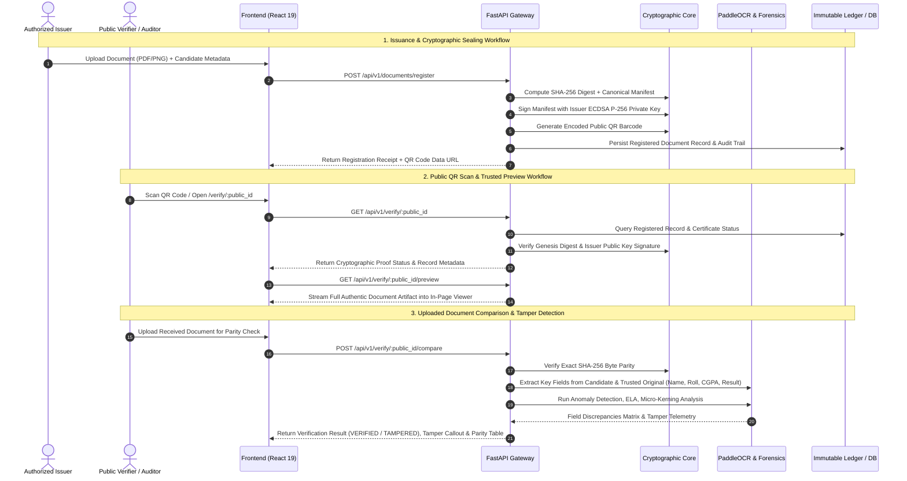

# VeriProof — Secure Digital Document Verification Platform

[](https://opensource.org/licenses/MIT)
[](https://fastapi.tiangolo.com)
[](https://react.dev)
[](https://www.python.org)
[](https://csrc.nist.gov/publications/detail/fips/186/4/final)
[](https://github.com/PaddlePaddle/PaddleOCR)

**VeriProof** is an enterprise-grade digital document issuance, cryptographic sealing, and AI/ML multi-signal verification platform. It solves physical document forgery, modified credentials, copied QR codes, and digital tampering through **FIPS 186-4 ECDSA P-256 digital signatures**, **SHA-256 genesis ledger anchors**, **PaddleOCR deep semantic parsing**, and **multi-modal AI image forensics**.

---

## 🏛️ 1. High-Level Technical Architecture

```
                                  ┌─────────────────────────────────────────────────────────┐
                                  │                USER & CLIENT INTERFACES                 │
                                  │  • Public Verification Portal (/verify/:id)             │
                                  │  • Issuer Dashboard (/issuer)                           │
                                  │  • Verifier Dashboard (/verifier)                       │
                                  │  • SuperAdmin Portal (/admin)                           │
                                  └────────────────────────────┬────────────────────────────┘
                                                               │ (HTTPS / REST / JSON)
                                                               ▼
┌────────────────────────────────────────────────────────────────────────────────────────────────────────────────────────┐
│                                             FASTAPI BACKEND GATEWAY (:8000)                                            │
│                                                                                                                        │
│  ┌─────────────────────────┐  ┌──────────────────────────┐  ┌──────────────────────────┐  ┌─────────────────────────┐  │
│  │   Authentication & RBAC │  │  Document Registration   │  │    Public Verification   │  │    Forensic Analysis    │  │
│  │  • JWT Access Tokens    │  │  • Canonical Manifest    │  │  • Ledger Resolution     │  │  • Multi-Signal Scoring │  │
│  │  • Email OTP Validation │  │  • ECDSA P-256 Signing   │  │  • Artifact Stream View  │  │  • Anomaly Detection    │  │
│  │  • Org Authorization    │  │  • SHA-256 Genesis Hash  │  │  • Live Document Compare │  │  • ELA / Micro-Kerning  │  │
│  └─────────────────────────┘  └──────────────────────────┘  └──────────────────────────┘  └─────────────────────────┘  │
└──────────────────┬───────────────────────────────────────────┬───────────────────────────────────────────┬─────────────┘
                   │                                           │                                           │
                   ▼                                           ▼                                           ▼
┌─────────────────────────────────────┐     ┌─────────────────────────────────────┐     ┌─────────────────────────────────┐
│     CRYPTOGRAPHIC INTEGRITY CORE    │     │       AI / ML & OCR PIPELINE        │     │     STORAGE & PERSISTENCE       │
│                                     │     │                                     │     │                                 │
│ • ECDSA P-256 (FIPS 186-4) Keypair  │     │ • PaddleOCR Deep Text Extraction    │     │ • PostgreSQL / Neon Production  │
│ • SHA-256 Genesis Content Digest    │     │ • PyMuPDF Vector & Block Parser     │     │ • SQLite In-Memory Test Engine  │
│ • Canonical JSON Manifest Parser    │     │ • Error Level Analysis (ELA) Engine │     │ • Secure Isolated File Storage  │
│ • QR Carrier Generator (SVG / PNG)  │     │ • Isolation Forest Anomaly Net      │     │ • Encrypted Tenant Artifacts    │
│ • CRL Revocation Status Ledger      │     │ • Field Parity Consistency Model    │     │ • Immutable Audit Trail Logs    │
└─────────────────────────────────────┘     └─────────────────────────────────────┘     └─────────────────────────────────┘
```

---

## 🔄 2. End-to-End System Workflow



---

## 🧩 3. Key Component Breakdown

### A. Client Tier (Frontend)
- **Framework:** React 19 + TypeScript + Vite 8
- **Styling:** Tailwind CSS + Custom Dark Mode Glassmorphic Design System
- **State & Context:** `AuthContext` (JWT & Session), `AppContext` (Audit Events & Notifications)
- **Document Rendering:** In-page zoomable PDF and image viewer with responsive pan/zoom (50%–200%), popout, and direct stream support.
- **Portals & Dashboards:**
  - **Public Verification Portal (`/verify`, `/verify/:id`):** Zero-trust verification report, cryptographic proofs, trusted document preview, uploaded document comparison dropzone, and OCR parity table.
  - **Verifier Dashboard (`/verifier`):** Real-time QR decoding, camera scanning, Document DNA analysis, forensic telemetry, and bulk verification.
  - **Issuer Dashboard (`/issuer`):** Single and bulk document registration, ECDSA signing, revocation controls, and audit logs.
  - **SuperAdmin Dashboard (`/admin`):** Organization oversight, KYC verification, issuer onboarding, and compliance exports.

### B. Backend API Gateway (FastAPI)
- **FastAPI (Python 3.12):** High-throughput asynchronous routing with Pydantic v2 validation.
- **Security & Authorization:** OAuth2 Bearer Tokens (JWT), Role-Based Access Control (`SUPER_ADMIN`, `ISSUER`, `VERIFIER`), rate limiting, and password hashing (PBKDF2 / Bcrypt).
- **Tenant Isolation:** Multi-tenant directory partitioning for document storage (`/storage/documents/{organization_id}/{uuid}`).

### C. Cryptographic Engine
- **Digital Signatures:** FIPS 186-4 ECDSA over NIST P-256 curve with SHA-256.
- **Canonical Manifests:** Deterministic JSON canonicalization (sorted keys, strict whitespace, ISO-8601 timestamps).
- **Genesis Digest Parity:** Bit-level SHA-256 hashing for tamper detection.
- **Revocation Protocol:** Immediate Certificate Revocation List (CRL) invalidation across the registry ledger.

### D. AI/ML & Forensics Pipeline
- **Optical Character Recognition (OCR):**
  - **PaddleOCR:** Multilingual deep-learning text detection (`DBNet`) and recognition (`SVTR / CRNN`).
  - **PyMuPDF (`fitz`):** Multi-page structural PDF layout, text span coordinates, and vector block parsing.
- **Semantic Field Comparator:**
  - Key attributes: `Student Name`, `Roll / Registration Number`, `Institution`, `Course / Branch`, `Semester`, `CGPA`, `SGPA`, `Result (PASS/FAIL)`, `Subject Grades`.
  - Categorical evaluations: `MATCH`, `MISMATCH`, `UNCERTAIN`, `NOT_EXTRACTED`, `NOT_CHECKED`.
- **Image Forensics Net:**
  - **Error Level Analysis (ELA):** Detects compression rate disparities between modified patches and original background.
  - **Micro-Kerning & Font Divergence:** Identifies font substitution and raster/vector mismatches.
  - **Copy-Move & Splicing Detection:** Flags patch cut-and-paste artifacts.
- **Anomaly Detection Net:**
  - `IsolationForest` models trained on visual layout boundary disparities and metadata integrity.

---

## 📂 4. Repository Structure

```
VeriProof/
├── backend/                             # FastAPI Backend Service
│   ├── app/
│   │   ├── api/v1/                      # REST Endpoints
│   │   │   ├── auth.py                  # Signup, Login, Email OTP
│   │   │   ├── documents.py             # Issuance, Preview, Verify, Compare
│   │   │   ├── forensics.py             # Document DNA & Forensic Engine
│   │   │   ├── ml.py                    # AI/ML Inference & Evaluation APIs
│   │   │   ├── organization.py          # SuperAdmin Oversight & KYC
│   │   │   └── health.py                # Health & Readiness Probes
│   │   ├── core/                        # Configuration & Security (JWT, Keys)
│   │   ├── db/                          # SQLAlchemy Base & Session Engine
│   │   ├── models/                      # Database Models (User, Org, RegisteredDoc)
│   │   ├── schemas/                     # Pydantic Schemas & DTOs
│   │   └── services/                    # Business Logic (Crypto, QR, Email, Document)
│   └── tests/                           # Backend Test Suite (172 tests)
│
├── ml/                                  # AI/ML Models & Feature Extraction
│   ├── artifacts/models/                # Pre-trained .joblib Models & registry.json
│   │   ├── anomaly_detection-*.joblib   # Isolation Forest Anomaly Net
│   │   ├── field_consistency-*.joblib   # Text Semantic Consistency Model
│   │   └── image_forensics-*.joblib     # Forensics ELA & Patch Classifier
│   ├── configs/                         # YAML Training & Pipeline Configurations
│   ├── reports/                         # Validation & Evaluation Manifests
│   ├── src/
│   │   ├── features/                    # Feature Extractors (ocr_features, forensics)
│   │   ├── inference_service.py         # Real-time Prediction Engine
│   │   └── train.py                     # ML Training Scripts
│   └── tests/                           # ML & Cryptographic Invariance Tests
│
├── src/                                 # Frontend React 19 Application
│   ├── components/                      # Reusable UI & Layout Components
│   ├── context/                         # AuthContext & AppContext
│   ├── hooks/                           # Custom React Hooks
│   ├── pages/                           # Application Pages
│   │   ├── PublicVerification/          # QR-Linked Document Verification & Preview
│   │   ├── Verifier/                    # Verifier Dashboard & Forensic Analysis
│   │   ├── Issuer/                      # Issuer Dashboard & Document Registration
│   │   └── SuperAdmin/                  # Admin Oversight & Registry Management
│   └── utils/                           # API Client (documentRegistryApi.ts)
│
├── datasets/                            # Synthetic & Benchmark Datasets
│   ├── reports/                         # Data Audit & Split Reports
│   └── synthetic/                       # Generated CSV & Parquet Benchmarks
│
├── pytest.ini                           # Pytest Configuration
├── tailwind.config.js                   # TailwindCSS Configuration
├── vite.config.ts                       # Vite Configuration & Proxy Rules
└── README.md                            # Technical Documentation
```

---

## 🗄️ 5. Database Schema (Entity-Relationship)

```
┌─────────────────────────┐           ┌─────────────────────────────┐
│      ORGANIZATIONS      │ 1       * │            USERS            │
├─────────────────────────┼───────────┼─────────────────────────────┤
│ id (PK)                 │           │ id (PK)                     │
│ name                    │           │ email (UQ)                  │
│ legal_name              │           │ full_name                   │
│ org_type                │           │ hashed_password             │
│ registration_number(UQ) │           │ role (SUPER_ADMIN/ISSUER/..)│
│ official_email          │           │ organization_id (FK)        │
│ status (ACTIVE/PENDING) │           │ is_active                   │
│ created_at              │           │ created_at                  │
└───────────┬─────────────┘           └──────────────┬──────────────┘
            │ 1                                      │ 1
            │                                        │
            │ *                                      │ *
┌───────────▼────────────────────────────────────────▼──────────────┐
│                        REGISTERED_DOCUMENTS                       │
├───────────────────────────────────────────────────────────────────┤
│ id (PK, UUID)                                                     │
│ public_verification_id (UQ, Indexed)                              │
│ title                                                             │
│ document_type (DEGREE, CERTIFICATE, LICENSE...)                   │
│ organization_id (FK -> organizations.id)                          │
│ issuer_user_id (FK -> users.id)                                   │
│ recipient_name                                                    │
│ recipient_identifier                                              │
│ recipient_email                                                   │
│ original_filename                                                 │
│ storage_key (UQ, UUID)                                            │
│ content_type                                                      │
│ size_bytes                                                        │
│ sha256_hash (Indexed)                                             │
│ signature_algorithm (ECDSA_P256_SHA256)                           │
│ signature_value                                                   │
│ signing_key_id                                                    │
│ signing_public_key                                                │
│ signed_manifest (Canonical JSON)                                  │
│ status (ACTIVE / REVOKED)                                         │
│ issue_date / issued_at                                            │
│ revoked_at / revocation_reason                                    │
│ version                                                           │
└───────────────────────────────────┬───────────────────────────────┘
                                    │ 1
                                    │
                                    │ *
                        ┌───────────▼───────────┐
                        │      AUDIT_EVENTS     │
                        ├───────────────────────┤
                        │ id (PK)               │
                        │ organization_id (FK)  │
                        │ user_id (FK)          │
                        │ event_type            │
                        │ details (JSON)        │
                        │ ip_address            │
                        │ created_at            │
                        └───────────────────────┘
```

---

## 🚀 6. Getting Started & Local Setup

### Prerequisites
- **Node.js** >= 18.x
- **Python** >= 3.11 (3.12 recommended)
- **PowerShell** (Windows) or **Bash** (macOS/Linux)

### 1. Clone the Repository
```bash
git clone https://github.com/Kashishk06/VeriProof.git
cd VeriProof
```

### 2. Backend Setup
```powershell
# Create Python virtual environment
python -m venv backend/.venv

# Activate virtual environment
.\backend\.venv\Scripts\Activate.ps1  # Windows
# source backend/.venv/bin/activate    # Linux / macOS

# Install dependencies
pip install -r backend/requirements.txt
```

### 3. Frontend Setup
```bash
npm install
```

### 4. Running the Development Servers

#### Terminal 1 — Start Backend Server:
```powershell
$env:PYTHONPATH="backend;."
.\backend\.venv\Scripts\python.exe -m uvicorn app.main:app --host 0.0.0.0 --port 8000 --reload
```
- **API URL:** `http://localhost:8000`
- **Interactive Swagger Documentation:** `http://localhost:8000/docs`

#### Terminal 2 — Start Frontend Server:
```powershell
npm run dev
```
- **Web Portal:** `http://localhost:5173`
- **Public Verification Route:** `http://localhost:5173/verify`

---

## 🧪 7. Automated Test Suite

VeriProof includes a strict 100% automated test suite verifying cryptographic invariants, role separation, OCR tampering detection, and public API resilience.

```powershell
# Run all 172 backend & ML tests
$env:PYTHONPATH="backend;ml;."
.\backend\.venv\Scripts\python.exe -m pytest -v

# Run Frontend Production Build Check
npm run build
```

---

## 🛡️ 8. Security & Cryptographic Invariants

- **No Blind Trust:** Uploading a modified document with a valid copied QR code fails cryptographic byte parity and triggers an OCR field mismatch alert.
- **Deterministic Manifest Signing:** JSON payloads are canonicalized with sorted keys and normalized representations before ECDSA P-256 signing.
- **Fail-Safe OCR:** Low-confidence extraction or unreadable scanned text produces `UNCERTAIN` or `INCONCLUSIVE` verdicts rather than falsely validating as genuine.
- **Isolated Tenant Storage:** Strict storage path sanitization prevents directory traversal attacks.

---

## 📄 License
This project is licensed under the MIT License — see the [LICENSE](LICENSE) file for details.
