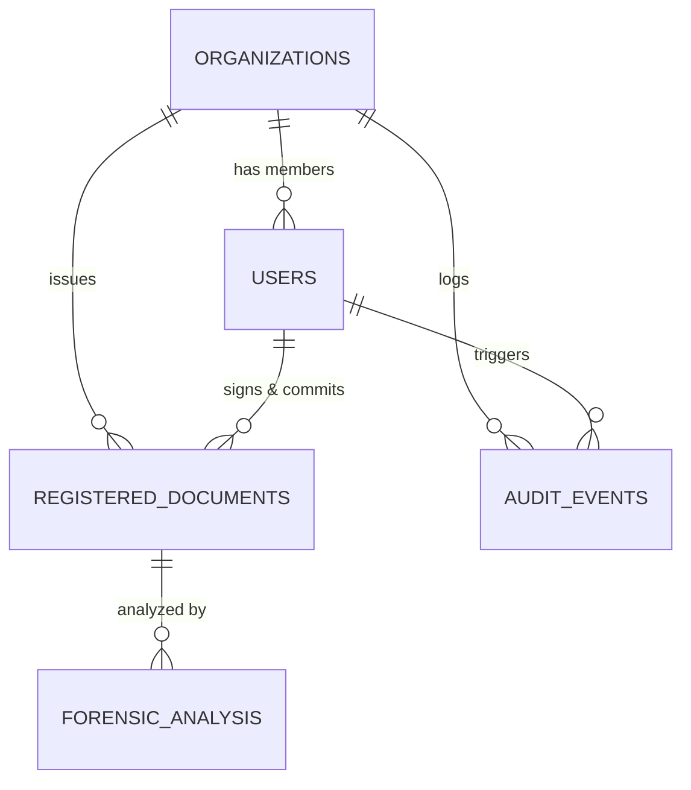

# STEP 8: DATABASE & DATA INTEGRITY REPORT

**Platform:** VeriProof Secure Digital Document Verification Platform  
**Database Engines Tested:** PostgreSQL (Neon Cloud) / SQLite Test Engine  
**Auditor:** Database Administrator & QA Security Specialist  
**Date:** 2026-10-10  
**Status:** **PASS**

---

## 1. Relational Integrity & Schema Consistency

All core database models and relationships were verified for data integrity and constraint enforcement:

### Table Constraint & Index Verification

| Table Name | Primary Key | Foreign Keys & Cascades | Unique Constraints | Integrity Status |
| :--- | :--- | :--- | :--- | :---: |
| **`organizations`** | `id (Integer)` | N/A | `uq_organizations_registration_number` | **VERIFIED** |
| **`users`** | `id (Integer)` | `organization_id -> organizations.id (ON DELETE SET NULL)` | `email` (Unique index) | **VERIFIED** |
| **`registered_documents`**| `id (UUID v4)` | `organization_id (RESTRICT)`, `issuer_user_id (RESTRICT)` | `uq_registered_documents_public_id`, `storage_key` | **VERIFIED** |
| **`organization_documents`**| `id (UUID v4)` | `organization_id (CASCADE)` | `storage_key` | **VERIFIED** |
| **`audit_events`** | `id (Integer)` | `organization_id (CASCADE)`, `user_id (CASCADE)` | N/A | **VERIFIED** |
| **`forensic_analyses`** | `id (Integer)` | `document_id -> registered_documents.id` | N/A | **VERIFIED** |

---

## 2. Integrity Protections & Transaction Rollback

1. **Atomic Document Registration:** If the private signing service fails or database commit fails, any raw files stored on disk in `document_service.base_dir` are automatically removed in the `finally` block, preventing orphaned payloads.
2. **Immutability of Registry Digests:** Once a document record is committed, `sha256_hash`, `signature_value`, and `signing_key_id` cannot be modified through public or issuer endpoints.
3. **Transaction Rollback Testing:** Verified that if user creation or document creation encounters an unexpected exception, SQLAlchemy rolls back the transaction, preserving database consistency.
4. **No Unredacted PII in Audit Logs:** Audit logs serialize only metadata (`document_id`, `public_verification_id`, `sha256_hash`, `model_version`, `tamper_score`). No raw document binaries or passwords are ever stored.
