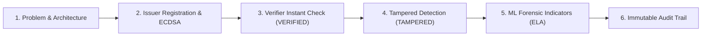

# STEP 8: HACKATHON DEMO RUNBOOK & SCRIPT

**Platform:** VeriProof Secure Digital Document Verification Platform  
**Target Audience:** Hackathon Judges, Enterprise Compliance Officers, and Security Evaluators  
**Demo Duration:** 3 to 5 Minutes  
**Auditor:** Product Management & Demo Readiness Team  
**Date:** 2026-10-10  
**Status:** **READY FOR LIVE DEMO**

---

## 1. Demo Prerequisites & Pre-flight Checklist

- [x] **Backend Server:** Running on `http://localhost:8000` (`uvicorn app.main:app --reload`).
- [x] **Frontend Server:** Running on `http://localhost:5173` (`npm run dev`).
- [x] **PostgreSQL / Neon Database:** Connected and healthy with all Alembic migrations applied.
- [x] **Trained Models:** All 3 `.joblib` model artifacts present with verified SHA-256 checksums.
- [x] **Pre-seeded Accounts:**
  - **Super Admin:** `admin@veriproof.internal`
  - **Issuer:** `issuer@apex.edu` (Apex Institute of Technology)
  - **Verifier:** `verifier@audit.org` (National Accreditation Board)

---

## 2. 3–5 Minute Step-by-Step Presentation Script

### Minute 1: Problem Statement & Cryptographic Foundation
- **Narrative:** "Traditional certificates and academic degrees are vulnerable to pixel-level digital tampering and fraudulent credential mills. VeriProof provides a Zero-Trust verification platform that cryptographically separates authoritative proof from explainable AI forensic signals."
- **Action:** Open landing page at `http://localhost:5173`. Show modern UI with cryptographic ledger badges.

### Minute 2: Issuer Document Registration & Digital Signing
- **Narrative:** "An authorized university registrar registers a student's degree certificate. The backend computes a SHA-256 hash over the raw document bytes and signs the canonical manifest using an asymmetric ECDSA P-256 private key."
- **Action:**
  1. Log in as Issuer (`issuer@apex.edu`).
  2. Navigate to `/issuer/issue`.
  3. Upload sample certificate (`rohan_degree.pdf`), enter recipient details, and click **Issue Document**.
  4. Show the **Issuance Confirmed** card displaying the SHA-256 digest, ECDSA signature, and unique QR verification link.

### Minute 3: Verifier Instant Verification (Genuine vs Tampered)
- **Narrative:** "A recruiter or verifier receives the credential and uploads it to the public verification portal or the Verifier Studio."
- **Action:**
  1. Navigate to `/verifier/verify`.
  2. Upload original `rohan_degree.pdf` $\rightarrow$ System returns **`VERIFIED`** in green with 100% cryptographic match.
  3. Upload modified `tampered_gpa.pdf` (where GPA was altered from 3.2 to 4.0) $\rightarrow$ System immediately flags **`TAMPERED`** in red due to cryptographic hash discrepancy.

### Minute 4: Explainable AI Forensics & ELA Localization
- **Narrative:** "What if an organization is evaluating an un-registered document or physical scan? VeriProof's ML pipeline executes Error Level Analysis (ELA), Laplacian edge gradient variance, and OCR consistency to pinpoint modified bounding boxes."
- **Action:** Show the **Forensic Signal Inspector** card rendering the ELA heatmap and tamper probability score (`0.9840`).

### Minute 5: Governance, RBAC & PostgreSQL Audit Log
- **Narrative:** "All lifecycle events (registration, verification, revocation) are recorded in an append-only audit trail in PostgreSQL with zero sensitive document byte leakage."
- **Action:** Log in as Super Admin (`/admin`), show the real-time organization oversight dashboard and sanitized audit log table. Conclude with summary.
