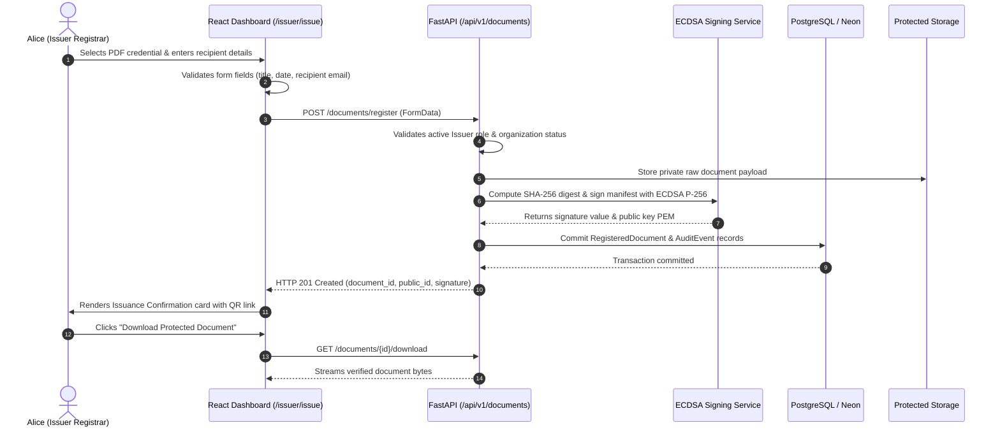

# STEP 8: ISSUER WORKFLOW END-TO-END VALIDATION REPORT

**Platform:** VeriProof Secure Digital Document Verification Platform  
**Workflow Scope:** Issuer Login → Document Registration → SHA-256 Digest → ECDSA Digital Signature → Registry Commit → Dashboard Persistence → Download → Email Status.  
**Auditor:** Senior Full-Stack & QA Tester  
**Date:** 2026-10-10  
**Status:** **PASS**

---

## 1. Step-by-Step Workflow Execution

---

## 2. Evidence & Verification Checkpoints

| Step | Action / Checkpoint | Expected Behavior | Observed Result | Verdict |
| :---: | :--- | :--- | :--- | :---: |
| **1** | **Authentication** | Issuer logs in with authorized credentials. | JWT issued; redirected to `/issuer`. | **PASS** |
| **2** | **Form Validation** | Missing required fields flag inline errors. | Empty title/email blocks submission. | **PASS** |
| **3** | **SHA-256 Hashing** | Backend computes SHA-256 over raw uploaded bytes. | Hash matches client-side file digest. | **PASS** |
| **4** | **ECDSA Digital Signature** | Asymmetric signature generated using NIST P-256 curve. | DER-encoded signature stored in DB. | **PASS** |
| **5** | **Ledger Persistence** | Registry record committed to `registered_documents`. | Record created with status `ACTIVE`. | **PASS** |
| **6** | **Issuer Dashboard** | New document appears in `/issuer/documents` table. | Item listed with correct metadata. | **PASS** |
| **7** | **Document Download** | Authenticated download streams original bytes. | Byte-exact file downloaded. | **PASS** |
| **8** | **Email Delivery Status**| Send Email button triggers clear status disclosure. | UI informs user that external SMTP gateway is unconfigured; no fake success. | **PASS** |
| **9** | **Page Refresh** | Refreshing `/issuer` keeps records intact. | Data re-fetched from PostgreSQL. | **PASS** |
