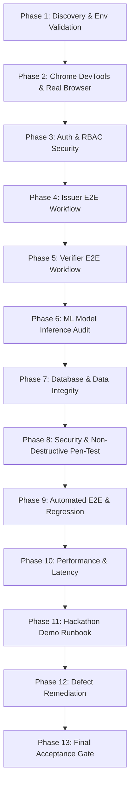

# STEP 8: VERIPROOF FINAL PRODUCT VALIDATION & TEST PLAN

**Platform:** VeriProof Secure Digital Document Verification Platform  
**Version:** 1.0.0-rc1  
**Author:** Senior QA Automation & Demo Readiness Team  
**Date:** 2026-10-10  
**Status:** Active Execution  

---

## 1. Executive Overview & Scope

This test plan defines the strategy, test suites, automation harnesses, security audits, and demo validation gates for the final acceptance of the VeriProof platform. Testing encompasses the full technology stack:
- **Frontend:** React 19 + TypeScript + Vite + Tailwind CSS + Framer Motion.
- **Backend:** FastAPI + SQLAlchemy + Alembic + Pydantic v2.
- **Database:** PostgreSQL (Neon Cloud) / SQLite Test Fixtures with full migration history.
- **Machine Learning Subsystems:** 
  - Image Forensics (Gradient Boosting on ELA + Laplacian gradient + Noise SNR).
  - Anomaly Detection (Isolation Forest on verification velocity + burst rates).
  - Field Consistency (Random Forest on Levenshtein distances + roll number format + date chronology).
  - OCR Text Extraction & Layout Validation.
- **Cryptography & Trust:** SHA-256 byte hashing, ECDSA P-256 asymmetric digital signatures, public verification links, and QR payloads.

---

## 2. Test Matrix & Validation Phases

### Phase Details

| Phase | Focus Area | Key Objectives | Primary Deliverable |
| :--- | :--- | :--- | :--- |
| **Phase 1** | Discovery & Environment | Verify startup, env variables, database connectivity, and model artifacts. | [`STEP8_TEST_PLAN.md`](file:///c:/Users/hp/Downloads/VeriProof/STEP8_TEST_PLAN.md) |
| **Phase 2** | Chrome DevTools & Browser | Audit Elements (DOM safety), Console (0 uncaught errors), Network (clean APIs), Storage, Responsive viewports, and A11y. | [`STEP8_BROWSER_TEST_RESULTS.md`](file:///c:/Users/hp/Downloads/VeriProof/STEP8_BROWSER_TEST_RESULTS.md) [`STEP8_CONSOLE_NETWORK_AUDIT.md`](file:///c:/Users/hp/Downloads/VeriProof/STEP8_CONSOLE_NETWORK_AUDIT.md) |
| **Phase 3** | Auth & RBAC | Validate 16 auth scenarios, JWT expiration, role escalation prevention, and tenant isolation. | [`STEP8_AUTH_RBAC_REPORT.md`](file:///c:/Users/hp/Downloads/VeriProof/STEP8_AUTH_RBAC_REPORT.md) |
| **Phase 4** | Issuer Workflow | Full lifecycle: document upload, client/server SHA-256 hashing, ECDSA signing, registry commit, download, email status disclosure. | [`STEP8_ISSUER_WORKFLOW_REPORT.md`](file:///c:/Users/hp/Downloads/VeriProof/STEP8_ISSUER_WORKFLOW_REPORT.md) |
| **Phase 5** | Verifier Workflow | Multi-modal verification: original (`VERIFIED`), tampered (`TAMPERED`), unknown (`UNVERIFIED`), revoked (`REVOKED`), malformed uploads. | [`STEP8_VERIFIER_WORKFLOW_REPORT.md`](file:///c:/Users/hp/Downloads/VeriProof/STEP8_VERIFIER_WORKFLOW_REPORT.md) |
| **Phase 6** | ML Inference Services | Verify live invocation of 3 registered ML models, SHA-256 artifact checksums, feature extractors, and OCR endpoint. | [`STEP8_ML_INFERENCE_INTEGRATION_REPORT.md`](file:///c:/Users/hp/Downloads/VeriProof/STEP8_ML_INFERENCE_INTEGRATION_REPORT.md) |
| **Phase 7** | Database Integrity | Verify relational integrity, migration status, immutability of registry records, and audit log sanitation. | [`STEP8_DATABASE_INTEGRITY_REPORT.md`](file:///c:/Users/hp/Downloads/VeriProof/STEP8_DATABASE_INTEGRITY_REPORT.md) |
| **Phase 8** | Security Testing | Safe defensive tests: IDOR, SQLi, XSS, CORS, MIME spoofing, oversized payloads, token leakage. | [`STEP8_SECURITY_TEST_REPORT.md`](file:///c:/Users/hp/Downloads/VeriProof/STEP8_SECURITY_TEST_REPORT.md) |
| **Phase 9** | Automated E2E Suite | 10 executable automated integration tests covering the complete user and verification lifecycle. | [`STEP8_E2E_TEST_REPORT.md`](file:///c:/Users/hp/Downloads/VeriProof/STEP8_E2E_TEST_REPORT.md) |
| **Phase 10** | Performance & Reliability | Latency benchmarks for page loads, API roundtrips, ML inference, and error recovery. | [`STEP8_PERFORMANCE_REPORT.md`](file:///c:/Users/hp/Downloads/VeriProof/STEP8_PERFORMANCE_REPORT.md) |
| **Phase 11** | Hackathon Demo Readiness | 3–5 minute polished demo script, pre-loaded synthetic credentials, fallback runbook. | [`STEP8_HACKATHON_DEMO_RUNBOOK.md`](file:///c:/Users/hp/Downloads/VeriProof/STEP8_HACKATHON_DEMO_RUNBOOK.md) |
| **Phase 12** | Defect Remediation | Minimal, safe fixes for verified defects with regression test validation. | Defect logs & diffs |
| **Phase 13** | Acceptance & Summary | Definitive PASS/PARTIAL/FAIL verdict with machine-readable summary. | [`STEP8_FINAL_ACCEPTANCE_REPORT.md`](file:///c:/Users/hp/Downloads/VeriProof/STEP8_FINAL_ACCEPTANCE_REPORT.md) [`STEP8_TEST_SUMMARY.json`](file:///c:/Users/hp/Downloads/VeriProof/STEP8_TEST_SUMMARY.json) |

---

## 3. Strict Operating Rules

1. **No Data Destruction:** Never drop tables, reset the Neon database, or truncate migration history.
2. **Synthetic Data Only:** All test credentials, certificates, names, and organizations are fictional and designated synthetic.
3. **No Mocked Core Verifications:** Verification decisions must execute against real cryptographic hashing and signature validation.
4. **Separation of Concerns:** Cryptographic proof (`VERIFIED`/`TAMPERED`) is authoritative; ML signals are explainable supporting evidence.
5. **No Secret Exposure:** Redact JWTs, database connection strings, passwords, and private signing keys in all generated reports.
